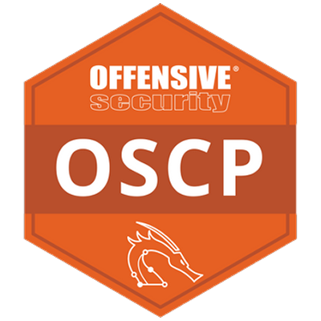
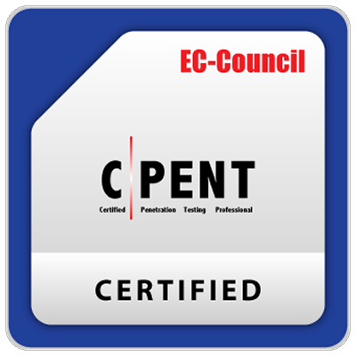
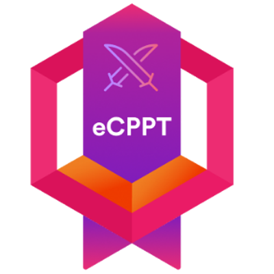
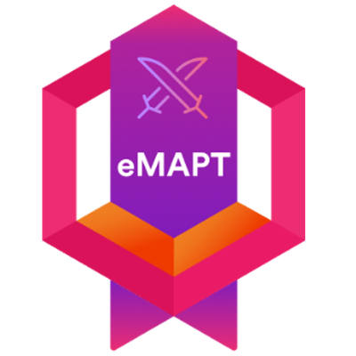
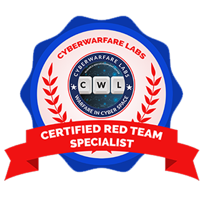
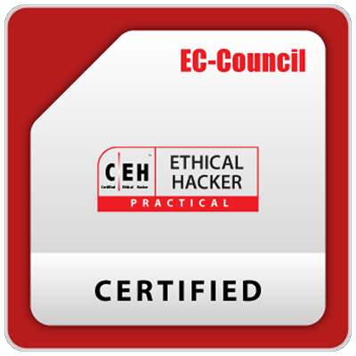
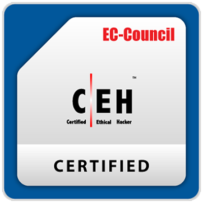

<a href="https://h4rithd.com">
  <picture>
    <source media="(prefers-color-scheme: dark)" srcset="./assets/banner-dark.svg">
    <source media="(prefers-color-scheme: light)" srcset="./assets/banner-light.svg">
    
  </picture>
</a>

<p align="center">
  <a href="https://h4rithd.com"></a>
  <a href="https://blog.h4rithd.com"></a>
  <a href="https://pentest.h4rithd.com"></a>
  <a href="https://app.hackthebox.com/profile/550483"></a>
  <a href="https://cv.h4rithd.com"></a>
</p>

<p align="center">
  <code>whoami</code> → <a href="#0x01-loot"><code>loot</code></a> → <a href="#0x02-nmap--sv-h4rithd"><code>recon</code></a> → <a href="#0x03-arsenal"><code>arsenal</code></a> → <a href="#0x04-in-production"><code>prod</code></a> → <a href="#0x05-exfil"><code>exfil</code></a>
</p>

## `0x00` whoami

```console
harith@field:~$ whoami
h4rithd
```

I'm **Harith Dilshan**. I find out how and why systems break, and I don't stop at the fix: I want the root cause.

My work is **web, mobile and network penetration testing**. Mobile holds a special place: apps that pin, obfuscate and detect, and the scripts it takes to see what they really do. Outside engagements I play CTFs, author Hack The Box machines, debug vulnerabilities down to the instruction, and write it all up on my [blog](https://blog.h4rithd.com) and [notes](https://pentest.h4rithd.com).

| `id h4rithd`   |                                                                    |
| :------------- | :----------------------------------------------------------------- |
| **Role**       | Offensive Security Engineer · 7+ years in cyber security           |
| **Practice**   | Web, mobile and network penetration testing                        |
| **Soft spot**  | Mobile application security                                        |
| **Exploring**  | Red teaming, AV evasion, malware analysis, hardware                |
| **Community**  | Hack The Box machine author · blog · open pentest notes            |
| **Education**  | SLIIT, specialising in Cyber Security                              |
| **Location**   | `/dev/null`                                                        |

## `0x01` loot

<p align="center">
  <a href="https://www.credential.net/d47f0b7b-cb87-4dc3-b4ea-498df7fa07aa"></a>
  <a href="https://aspen.eccouncil.org/VerifyBadge?type=certification&a=1LYwlgenuppwHx3d9nWh95L/4QUjz8OVxvqphb5dhWQ="></a>
  <a href="https://www.credential.net/15172f35-44b0-45c0-b9bc-ea122c51307f"></a>
  <a href="https://www.credential.net/3873ff06-43e5-4054-9c48-a0b2fc783685"></a>
  <a href="https://www.credential.net/c80568be-2b18-4dae-b9b9-ec743fe8e9a5"></a>
  <a href="https://aspen.eccouncil.org/VerifyBadge?type=certification&a=hrh5u5BN7tpBPrNa4iembY0FdEiqRbmviWUXqCxTbfg="></a>
  <a href="https://aspen.eccouncil.org/VerifyBadge?type=certification&a=qWH4heUqwAj7/QDQCz21ZSDsO+xmKYBm+w0HyMIFpB0="></a>
  <a href="https://aspen.eccouncil.org/VerifyBadge?type=certification&a=Dgy3jUvoy4X60j8c5XvsRKgtLu1zpcLcFnecYVwWLV8="></a>
  <a href="https://www.credential.net/7662e615-9dc2-41b1-8000-f213dfecc53d"></a>
  <a href="https://app.hackthebox.com/profile/550483"></a>
</p>

<p align="center"><sub>Every badge links to its verification page.</sub></p>

## `0x02` nmap -sV h4rithd

```console
harith@field:~$ nmap -sV -p- --open h4rithd
Nmap scan report for h4rithd (h4rithd.com)
Host is up (0.00s latency, always).

PORT       STATE     SERVICE        VERSION
443/tcp    open      web-appsec     Burp Suite, ffuf, feroxbuster, SQLMap · manual-first, chain to impact
5555/tcp   open      adb            Android, jadx, Magisk · Burp CA in the system store
27042/tcp  open      frida          Frida · scripted pinning and root-detection bypass, Android + iOS
88/tcp     open      kerberos       Rubeus, Certipy, Impacket
445/tcp    open      microsoft-ds   BloodHound, Mimikatz, Nishang · pivots through Ligolo-ng
1234/tcp   open      gdbserver      Ghidra, Cutter, radare2, dnSpy, GDB + GEF · read the binary
50050/tcp  filtered  cs-teamserver  Cobalt Strike, Covenant, Empire, PowerSploit · still exploring

Service Info: OS: macOS arm64, Kali; Langs: Python, Bash, PowerShell, Swift, Java, C#, TypeScript

Nmap done: 1 IP address (1 host up), 7 services, 0 assumptions left untested
```

## `0x03` arsenal

Tools I needed during engagements, so I built them.

| id     | tool | what it does | stack | |
| :----- | :--- | :----------- | :---- | :-- |
| `0x01` | **[PrecompiledBinaries](https://github.com/h4rithd/PrecompiledBinaries)** | Curated precompiled Windows and Linux binaries for AD testing, privesc labs and post-exploitation | PowerShell |  |
| `0x02` | **[VulnStudio](https://github.com/h4rithd/VulnStudio)** | Open-source vulnerability report generation for pentesters and VAPT teams | TypeScript |  |
| `0x03` | **[BurpSuiteCert](https://github.com/h4rithd/BurpSuiteCert)** | Magisk module that installs the Burp CA into Android's system trust store | Shell |  |
| `0x04` | **[CVSS v3.1 Visual Calculator](https://github.com/h4rithd/CVSS-v3.1-Visual-Calculator-BApp)** | Burp Suite extension: CVSS v3.1 scoring with an interactive risk meter | Java |  |
| `0x05` | **[RevSh3ll-HTB](https://github.com/h4rithd/RevSh3ll-HTB)** | Reverse shell generator for Hack The Box, in pure bash | Shell |  |
| `0x06` | **[SecHead](https://github.com/h4rithd/SecHead)** | Audits security headers: CSP, HSTS, clickjacking and HTTP hardening | Python |  |

<details>
<summary><code>harith@field:~$ ls ~/scripts</code> &nbsp;small tools from the field</summary>
<br>

| script | does |
| :----- | :--- |
| [TimeQLInjection](https://github.com/h4rithd/TimeQLInjection) | Time-based blind SQLi: databases, tables, columns and data, GET or POST |
| [SubD0m](https://github.com/h4rithd/SubD0m) | Subdomain fetcher using crt.sh |
| [CSPGenPro](https://github.com/h4rithd/CSPGenPro) | Crawls a site and reports the external domains a CSP has to allow |
| [csrfb33f](https://github.com/h4rithd/csrfb33f) | Brute-forcing through CSRF tokens |
| [imp-fuzzer](https://github.com/h4rithd/imp-fuzzer) | Mass endpoint fuzzing |
| [cruNch3r](https://github.com/h4rithd/cruNch3r) | Mass live-host checks |
| [BruteSSH](https://github.com/h4rithd/BruteSSH) | Bulk SSH login checks |
| [UserNameGen](https://github.com/h4rithd/UserNameGen) | Username lists in common corporate formats |
| [awsTokenEx](https://github.com/h4rithd/awsTokenEx) | Pulls temporary AWS credentials out of an env file into `~/.aws` |
| [FridaOnBoot](https://github.com/h4rithd/FridaOnBoot) | Magisk module that starts `frida-server` as root on every boot |
| [KaliKonfiger](https://github.com/h4rithd/KaliKonfiger) | Automated Kali Linux setup and customisation |

</details>

**Off the clock**, I build native tools for the machines I work on:

| tool | what it does | stack | |
| :--- | :----------- | :---- | :-- |
| **[OdinMac](https://github.com/h4rithd/OdinMac)** | Samsung firmware flashing, rebuilt for Apple Silicon: slot-aware loading, PIT mapping, live Heimdall logs | SwiftUI |  |
| **[RufusMac](https://github.com/h4rithd/RufusMac)** | Bootable Windows and Linux USB installers on macOS, with Windows 11 bypass and multiboot | SwiftUI |  |
| **[RufusPS](https://github.com/h4rithd/RufusPS)** | The same job from PowerShell, with safe USB selection | PowerShell |  |
| **[iAppGone](https://github.com/h4rithd/iAppGone)** | Lists and completely uninstalls macOS apps, Homebrew included · [PyPI](https://pypi.org/project/iAppGone/) | Python |  |

## `0x04` in production

Things I built properly and kept online. Most run entirely in your browser: nothing to trust but the code.

| host | what it is | trust model |
| :--- | :--------- | :---------- |
| **[bin.h4rithd.com](https://bin.h4rithd.com)** | **h4\|Bin**, a zero-knowledge pastebin. The paste lives inside the link. | AES-256-GCM in the browser · no servers · no tracking |
| **[passbox.h4rithd.com](https://passbox.h4rithd.com)** | **PassBox**, a password generator | Web Crypto API · nothing stored or sent |
| **[tools.h4rithd.com](https://tools.h4rithd.com)** | A pentest workbench for encoding, cryptography and analysis | Client-side only |
| **[vulndb.h4rithd.com](https://vulndb.h4rithd.com)** | **VulnDB**: CVE search, CVSS 3 calculator, remediation guidance | Public vulnerability data |
| **[vulnstudio.com](https://vulnstudio.com)** | **VulnStudio**, report generation for VAPT teams | Open source |
| **[odinmac.h4rithd.com](https://odinmac.h4rithd.com)** | **OdinMac**, a Galaxy flasher for Apple Silicon | Native app · open source |

## `0x05` exfil

```console
harith@field:~$ cat ~/.contact
mail     hello@h4rithd.com
web      https://h4rithd.com
resume   https://cv.h4rithd.com
x        @h4rithd
```

A security challenge, a research question, or something worth taking apart. I read everything that lands in my inbox.

<p>
  <a href="mailto:hello@h4rithd.com"></a>
  <a href="https://www.linkedin.com/in/harithdilshan/"></a>
  <a href="https://x.com/h4rithd"></a>
  <a href="https://app.hackthebox.com/profile/550483"></a>
</p>

<p align="center">
  <sub><code>break / understand / defend</code> &nbsp;·&nbsp; only test what you're authorized to test</sub>
  <br>
  
</p>
